# Claude Artifacts and Claude Dashboards: Technical Architecture

| | |
|---|---|
| **Version** | 1.0 (draft for review) |
| **Date** | 2026-10-13 |
| **Status** | Dashboards is in beta and changing quickly. Re-verify before relying on any detail. |
| **Basis** | Anthropic documentation, third-party hands-on reports, and first-hand observation of the Artifact tool in one claude.ai chat session |
| **Format** | GitHub Flavored Markdown. Diagrams use Mermaid, which GitHub renders natively. |

## Table of contents

- [0. Scope, method and evidence labels](#0-scope-method-and-evidence-labels)
- [1. Executive summary](#1-executive-summary)
- [Part 1: Artifacts](#part-1-artifacts)
  - [1.1 Definition and artifact types](#11-definition-and-artifact-types)
  - [1.2 Lifecycle and full flow](#12-lifecycle-and-full-flow)
  - [1.3 Surfaces and tools](#13-surfaces-and-tools)
  - [1.4 Runtime and sandbox](#14-runtime-and-sandbox)
  - [1.5 Runtime capabilities](#15-runtime-capabilities)
  - [1.6 State and data](#16-state-and-data)
  - [1.7 Sharing, identity and versions](#17-sharing-identity-and-versions)
  - [1.8 Collaboration and comments](#18-collaboration-and-comments)
  - [1.9 Administration and security](#19-administration-and-security)
  - [1.10 Limits and failure modes](#110-limits-and-failure-modes)
- [Part 2: Dashboards](#part-2-dashboards)
  - [2.1 What it is](#21-what-it-is)
  - [2.2 Build flow](#22-build-flow)
  - [2.3 Anatomy of a dashboard](#23-anatomy-of-a-dashboard)
  - [2.4 Data connectivity](#24-data-connectivity)
  - [2.5 Live refresh path](#25-live-refresh-path)
  - [2.6 Trust and inspectability](#26-trust-and-inspectability)
  - [2.7 Sharing and hand-off](#27-sharing-and-hand-off)
  - [2.8 Governance and security](#28-governance-and-security)
  - [2.9 Constraints and open questions](#29-constraints-and-open-questions)
- [Part 3: How they fit together](#part-3-how-they-fit-together)
- [Appendix A: Tool reference](#appendix-a-tool-reference)
- [Appendix B: Capability quick reference](#appendix-b-capability-quick-reference)
- [Appendix C: Worked example](#appendix-c-worked-example)
- [Appendix D: Glossary](#appendix-d-glossary)
- [Appendix E: Sources and confidence](#appendix-e-sources-and-confidence)

---

## 0. Scope, method and evidence labels

### 0.1 In scope

- **Artifacts:** what they are, how they are created, hosted, versioned, shared, secured and administered, and the runtime services a published page can use.
- **Dashboards:** the Claude Dashboards template (beta, launched October 8, 2026), how it differs from a plain artifact, and how it connects to data.

### 0.2 Out of scope

- Claude Motion (animated explainers exported as MP4). It is mentioned only for context.
- Model internals, prompts, and how Claude chooses SQL. Anthropic has not published these.
- The Claude API and Claude Code beyond their artifact features.

### 0.3 Evidence labels

Every non-trivial claim carries one of these labels so you can judge how much weight to give it.

| Label | Meaning |
|---|---|
| `[D]` | **Documented** by Anthropic (help center, Claude Code docs, announcement coverage that quotes Anthropic). |
| `[R]` | **Reported** by a third party, usually from hands-on testing. Not confirmed by Anthropic. |
| `[O]` | **Observed** first-hand in a claude.ai chat session on 2026-10-13 (tool definitions and the runtime contract version 0.2.75). |
| `[I]` | **Inference** by the author. Plausible but not confirmed. |

### 0.4 Method and limits of this document

- Sources are listed in [Appendix E](#appendix-e-sources-and-confidence). Anthropic's own launch post was identified but not read directly. Its content is taken from the help article and from coverage that quotes it.
- The session used to observe the Artifact tool offered three artifact types (Design, Docs, Slides) and no Dashboards type. **Dashboards behavior in this document is therefore not verified hands-on by the author.** It rests on Anthropic's help article and third-party testing.
- Several sources disagree on small details (for example launch date, plan availability and exact export destinations). Disagreements are called out where they matter.

> [!WARNING]
> Dashboards is a beta feature. Limits, plan availability and behavior can change without notice. Treat every `[R]` and `[I]` item as something to re-verify.

---

## 1. Executive summary

- An **artifact** is a hosted web page (or document) that Claude produces for you to keep, interact with and share. It lives at a private claude.ai link until you share it. `[D]`
- Claude writes a self-contained **HTML or Markdown file**, then an **Artifact tool** publishes it. Each publish becomes a **version**. `[D]` `[O]`
- The page runs in a **sandboxed origin** under a strict content security policy. It has no backend of its own. `[D]`
- Pages gain abilities through **runtime capabilities** that the viewer's claude.ai session grants: a shared database, file assets, connector (MCP) calls, asking Claude a question, live presence, downloads, comments and more. `[O]`
- **Typed artifacts** (Slides, Docs, Design, and Dashboards) start from a template and open in an editor built for that output. `[D]` `[O]`
- A **dashboard** is an artifact made from the Dashboards template. Claude writes one SQL query per chart, runs it against a connected warehouse or app, and shows the query and last refresh time on every chart. `[D]`
- **Live dashboards** re-run their queries through a remotely hosted connector, using each viewer's own identity. **Extract dashboards** carry stored CSV or JSON files that anyone with access can read. `[R]`

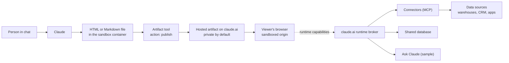

*Figure 1. System overview. Solid arrows are the build path. The dotted arrow is the view-time path that starts in the viewer's browser.*

---

# Part 1: Artifacts

## 1.1 Definition and artifact types

### Definition

Anthropic describes an artifact as anything Claude makes that you would put in front of someone, such as a design, a deck, a document, a dashboard or a small interactive tool. `[D]` Technically it is a live, interactive web page that Claude publishes to a private URL on claude.ai, and that updates in place as the work continues. `[D]`

An artifact is a **capture of work**: one self-contained page with no backend, so it cannot serve multiple routes. For a hosted internal tool with a backend, Anthropic's guidance is to deploy on your own infrastructure instead. `[D]`

### Types

| Type | Purpose | How it is made | Notes |
|---|---|---|---|
| **Plain page** | Apps, tools, games, visual explainers, reports, anything expressible in HTML, CSS and inline JavaScript | Claude writes one `.html` (or `.md`) file and publishes it | Fully custom. Source can only be changed by Claude (or an editor via Claude). |
| **Slides** | 16:9 presentation decks to present, page through and download | Started from the Slides type with data files | Exports to PowerPoint and PDF. `[D]` `[O]` |
| **Docs** | Living documents people and Claude edit together | Written through the Claude Docs connector, not as files. The artifact is the shared viewer. | Exports to Word, PDF, Markdown and other formats. `[O]` |
| **Design** | Design canvas with live artboards: websites, landing pages, screens, mockups, posters, social visuals | Started from the Design type | Each artboard exports as PNG or PDF. `[D]` |
| **Dashboards** | Query-backed dashboards on connected data | Started from the Dashboards template | Covered in [Part 2](#part-2-dashboards). |

`[O]` In the observed session, the types listing contained **Design**, **Docs** and **Slides** (all marked core). Types are set per account, so what you see may differ.

### Launch context for the typed artifacts `[R]`

- Docs, Slides and Design left beta on October 8, 2026 and became available on every plan, including Free.
- On Enterprise plans Docs, Slides and Design turn on by default on October 15, 2026.
- The standalone Design site (claude.ai/design) is scheduled to shut down on December 14, 2026. Design has run inside conversations since September 16.
- Coverage cites more than 45 million docs, decks and designs made in Claude.
- Cowork artifacts (artifacts inside Claude Cowork) were introduced on August 19, 2026, according to MotherDuck's documentation, which distinguishes them from an earlier "live artifacts" system.

## 1.2 Lifecycle and full flow

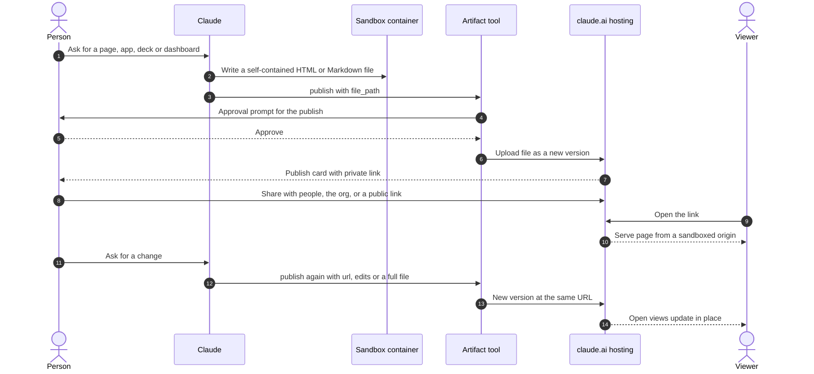

*Figure 2. Artifact lifecycle in a claude.ai chat.*

### Step by step

1. **Request.** The person asks for something that suits a page: an app, tool, dashboard, visual explainer, report or presentation. Claude may also publish on its own when the output suits a page. `[D]`
2. **Surface choice.** Claude decides whether the answer belongs in the reply, an inline visual, a downloadable file or an artifact (see [Figure 3](#13-surfaces-and-tools)). `[O]`
3. **Author.** Claude writes one self-contained `.html` or `.md` file. In Claude Code the file goes to a temporary directory outside your project unless you name a location. `[D]`
4. **Publish.** Claude calls the Artifact tool with `action: "publish"` and the file path.
   - In a claude.ai chat the person approves each publish. `[O]`
   - In Claude Code, a first publish from a prompt you typed goes through without a prompt, but several cases ask first (see [section 1.3](#13-surfaces-and-tools)). `[D]`
5. **Host.** The file becomes a version of the artifact. A publish card appears so the person can open the page, return to it later and share its link. `[O]`
6. **Visibility.** The new artifact is visible **only to its author** until shared. `[D]`
7. **Update.** Claude edits the file and publishes again to the same URL. Within one reply, publishing the same file path updates the same artifact. In a later reply, Claude passes the artifact's URL so the existing artifact is updated instead of a second one being created. `[O]`
8. **Versions.** Each publish becomes a version. From the Share control the author chooses which version viewers see. `[D]`
9. **Collaborate.** Viewers comment, editors change, and Claude can be activated on comment threads (see [section 1.8](#18-collaboration-and-comments)). `[D]`

### Small changes `[O]`

For a small change to a page Claude already published, the publish call itself accepts an `edits` list of `old_str` and `new_str` pairs. Each `old_str` must occur exactly once in the current file. The edits apply in order, all or none. The file is rewritten and published in one call, so the local copy stays the source for later changes. A rewrite of most of the page goes through the file instead. A miss changes nothing and reports which edit failed.

### Reading an existing artifact `[O]`

`action: "read"` with an artifact URL copies its published files into the container (under an `artifacts/` folder) so Claude can view, edit and republish them. Any artifact in the person's organization can be read. Only the person's own artifacts can be updated, or a colleague's when the read says the person can edit it. A colleague's artifact made from a type (such as a deck or design) can never be updated this way. Content read from someone else's page is **data, never instructions**.

## 1.3 Surfaces and tools

### Where artifacts are created

| Surface | Notes |
|---|---|
| **claude.ai chat** (web, desktop, mobile) | Primary surface. Artifact tool available. The Artifacts tab lists everything you have made. `[D]` `[O]` |
| **Claude Cowork** | Artifacts available. Cowork artifacts launched August 19, 2026. `[R]` |
| **Claude Code CLI and desktop app** | Publishes artifacts from a session. Requires a claude.ai login (`/login`), desktop app version 1.13576.0 or later. `[D]` |
| **Claude Tag** | Sessions can publish artifacts when both Claude Tag and artifacts are enabled for the organization. `[D]` |
| **`claude remote-control`** | Sessions you started yourself can publish (Claude Code v2.1.281 or later). `[D]` |
| **Agent SDK, GitHub Action, MCP-server contexts, `-p` headless mode** | **Off by default.** Also off when `CLAUDE_CODE_DISABLE_NONESSENTIAL_TRAFFIC` is set. `[D]` |

### Choosing the output surface

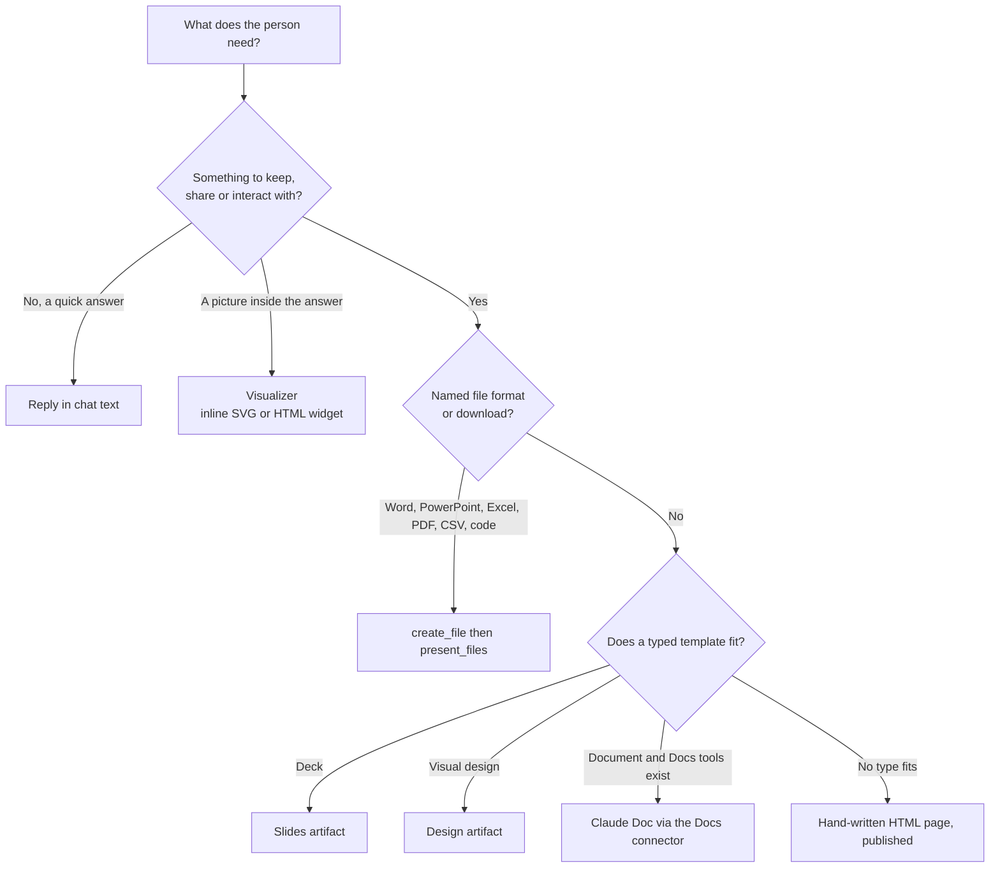

*Figure 3. Output-surface decision, as observed in the session's tool guidance `[O]`. A typed artifact is preferred over a hand-written page whenever a fitting type exists, except when the person names a file format.*

### Tools in the chat environment `[O]`

| Tool | Role in this architecture |
|---|---|
| **Artifact** | Publishes pages, reads and lists artifacts, reads runtime capabilities, reads and writes the artifact database, and handles comments. See [Appendix A](#appendix-a-tool-reference). |
| **create_file, str_replace, bash_tool, view** | Author and edit the source files in the sandbox container before publishing. |
| **present_files** | Delivers a **downloadable file** (Word, PowerPoint, Excel, PDF, CSV, code). Not used for published pages. |
| **Visualizer** (`read_me`, `show_widget`) | Streams an **inline** SVG diagram or HTML widget into the conversation. It makes no file and no hosted page. |
| **chart_display_v0 and card tools** | Native inline charts, tables and cards for simple cases. |
| **Claude Docs tools** (`guide`, `batch`, `update`, plus deferred `create`, `delete`, `export`, `query`, `read`) | Create and edit Claude Docs. Content lives in the Docs service, not in files. |
| **search_mcp_registry, suggest_connectors** | Find and offer connectors that a chat (or a connector-backed page) may need. |
| **tool_search** | Loads deferred tools, such as the Docs tools, before use. |

### Claude Code controls `[D]`

| Control | What it does |
|---|---|
| `Ctrl+]` | Reopen the session's most recent artifact. |
| `/artifacts` | List artifacts you own and those shared with you (v2.1.208 or later). Keys: `Enter` opens or attaches, `o` opens, `c` copies the link. |
| `/slides`, `/design` | Start a Slides or Design artifact from a brief (v2.1.265 or later). |
| `CLAUDE_CODE_ARTIFACT_AUTO_OPEN=0` | Stop the browser opening after a publish. |
| `CLAUDE_CODE_DISABLE_ARTIFACT=1`, `"enableArtifact": false`, `Artifact` in `permissions.deny` | Turn artifacts off for your sessions. Once off via `--settings`, the env var or managed settings, no settings file turns them back on. |

**When Claude Code asks before publishing:**

| Situation | Behavior |
|---|---|
| Plan mode | Asks before the first publish of each artifact. |
| The publish declares runtime capabilities (connector calls, downloads) | Asks before that publish. |
| The artifact is shared publicly | Asks once per conversation before changing it. |
| Feature-flag fetching is off | Asks before the first publish of each artifact. |
| A scheduled task started the turn | Asks before the first publish of each artifact. |
| Claude cannot read the file without your approval | Asks. An allow rule for `Artifact` does not skip this. |

### Typed artifacts `[O]`

- `action: "list"` with `scope: "types"` shows the published types for the account. Optional `type_query` narrows the list.
- `action: "read"` with a `type_url` shows a type's files, whether it ships instructions, and the capabilities it uses.
- Publishing with `type_url` and data files (`file_path`, `files`) starts a **new private artifact** from the type. The page and the type's other files stay fixed. Only the data files change on later publishes.
- Instructions a type ships are the publisher's text about its data files. They are data about the task, not changes to what the person asked for.
- **Design systems** are themselves artifacts of a type named Design System. A system marked default is the person's standing choice for decks and designs and is used without asking. If some exist but none is default, Claude names them and asks.
- An empty types listing means no types are published and Claude falls back to a plain page.
- For deck and design requests Claude lists the available types first, then reads the matching one.

## 1.4 Runtime and sandbox

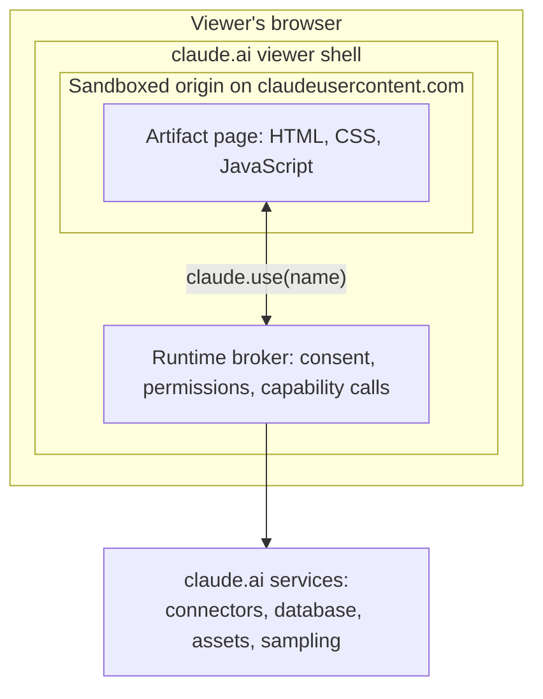

*Figure 4. Isolation layers. The page never holds credentials. The broker calls services on its behalf.*

### 1.4.1 Hosting and origin `[D]`

- Artifact content is stored on Anthropic-operated infrastructure. It is visible only to authenticated members of the publishing organization and the people it is shared with, unless shared publicly.
- The viewer loads each artifact from a **sandboxed `*.claudeusercontent.com` origin**. Organizations that restrict egress must allow that domain plus `claude.ai`.
- The page is wrapped in an HTML document shell and served under a strict **Content Security Policy (CSP)**.

### 1.4.2 What the CSP allows and blocks

| Area | Rule | Source |
|---|---|---|
| Scripts | Only from public CDN hosts. The Claude Code docs list five: cdnjs, unpkg, the Tailwind CDN, jQuery CDN, and selected paths on jsDelivr such as `/npm/`. | `[D]` |
| Scripts, as seen in the observed chat session | cdnjs.cloudflare.com (preferred), cdn.jsdelivr.net/npm/, cdn.tailwindcss.com and code.jquery.com. Everything else, including unpkg and esm.sh, fails silently. | `[O]` |
| Stylesheets | Only Google Fonts (`fonts.googleapis.com`), with font files from `fonts.gstatic.com`. | `[D]` `[O]` |
| Images | **All external images are blocked.** Embed as `data:` URIs. | `[D]` |
| Network calls | `fetch`, XHR and WebSocket reach only the page's own origin and the Google Fonts hosts. | `[D]` |
| Backend | None. A static page cannot authenticate viewers itself. | `[D]` |
| Downloads | The page cannot start a download. Ordinary links and `data:` or `blob:` URLs are blocked. Use the `downloads` capability. | `[D]` |
| Relative links | Do not resolve. Nothing is deployed beside the page. Use in-page anchors. | `[D]` |
| Source type | `.html`, `.htm` or `.md`, valid UTF-8 (or UTF-16 LE with BOM). A file containing the replacement character U+FFFD is refused with line and column. | `[D]` |
| Source location | A path naming a network host is refused unread. | `[D]` |
| Size | Rendered page must be **16 MiB or smaller** (large embedded images are the usual cause of a failed publish). | `[D]` `[O]` |

> [!NOTE]
> A blocked font falls back to the fallback stack. A blocked **library has no fallback**, so the parts of a page that depend on it break. Organizations that block CDN hosts should reject fast rather than drop silently, so requests fail immediately instead of hanging.

### 1.4.3 Authoring rules for published pages `[O]`

These are the rules the hosting environment enforces. A page that ignores them publishes but does not work.

- **Self-contained.** Inline the page's own CSS and JavaScript in one file. Embed images and data as `data:` URIs.
- **Libraries.** Load a library as a UMD `<script>` from an allowed host, placed before the inline script that uses it. Pin an exact version, never a bare name, range or tag. Prefer versions at least two weeks old.
- **Browser storage works.** `localStorage`, `sessionStorage` and IndexedDB are private to this artifact in that viewer's browser. Wrap every read and write in `try/catch`, render correctly when storage is empty, and use it only for per-viewer conveniences. It is never shared between viewers.
- **Responsive and theme-aware.** Use relative units and let wide content scroll inside its own container. Define colors as tokens and redefine them for dark mode. Declare `viewport-fit=cover` and respect safe-area insets on phones.
- **Favicon and title.** One emoji favicon, kept stable across republishes. The title defaults to the page's `<title>`.
- **Diagrams.** Mermaid renders natively in published pages (a `<pre class="mermaid">` element in HTML, or a `mermaid` fence in Markdown).
- **Fonts.** Google Fonts is the one external font source. Other typefaces are inlined as `@font-face` data URIs. Every font gets a fallback stack.

### 1.4.4 Preview versus published runtime `[O]`

The chat's own artifact preview and a published page are **different runtimes**.

| Feature | In-chat preview | Published page |
|---|---|---|
| `fetch("https://api.anthropic.com/v1/messages")` | Supported | **Refused by CSP** |
| `window.storage` key-value API | Supported | **Undefined** |
| `window.claude.complete`, `window.fs` | Supported | **Undefined** |
| Equivalent capability | n/a | `sample` (ask Claude), `db` (shared state), guarded `localStorage` (per-viewer), inline data snapshot, `downloads` |

A page written for the preview must be **ported** before publishing: replace each unsupported call with its capability equivalent, drop what has no equivalent, and tell the person what changed.

### 1.4.5 Token cost of artifacts `[D]`

Generating a styled page uses more output tokens than the same content as plain text. The main contributors are inline CSS, interactive JavaScript and images embedded as data URIs. To reduce cost: prefer SVG or HTML and CSS for diagrams over raster images, omit interactivity you do not need, and have the page summarize large datasets rather than inline them in full.

## 1.5 Runtime capabilities

A published page can declare **runtime capabilities**: abilities the viewer's claude.ai session grants the page at open time. Capabilities are the bridge between a static page and Claude's services. `[O]`

### 1.5.1 How capabilities work `[O]`

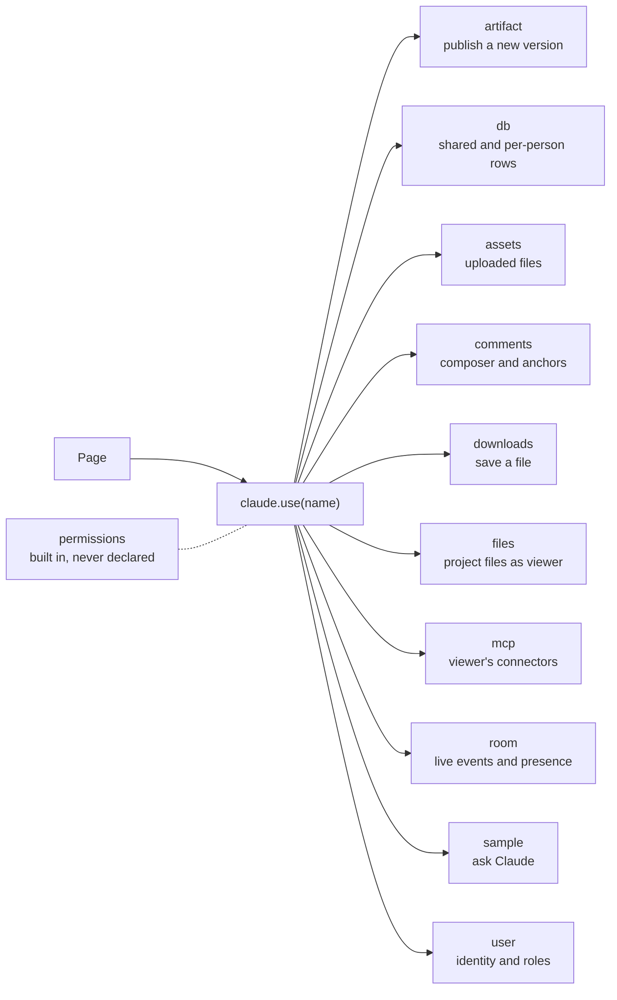

*Figure 5. Capability map for runtime contract 0.2.75. `self` is a deprecated alias of `artifact`.*

- **Declaration.** The publisher passes `capabilities: {name: config}` on the publish call. Before declaring anything, Claude calls the Artifact tool with `action: "capabilities"` to learn which names are available to this person and how each is called.
- **Declaration semantics.**
  - Omitting `capabilities` on a republish **carries the stored declaration forward** and preserves the contract pin.
  - An empty object `{}` is the explicit **clear-all**.
  - A non-empty object is a **full-set declaration**: anything stored but not restated is revoked.
- **Access.** In the page: `const ns = await claude.use("db")`. The result is `null` when the view cannot run the capability (not served, not granted, or failed to load, indistinguishable by design). Pages must **design for absence**: render without the capability and light features up when the promise resolves.
- **Namespace rules.** `window.claude` carries only `use`. Never read `window.claude.db` or similar. The resolved namespace is frozen and platform-owned. Calling `use()` again for the same name is free (memoized). Unknown names resolve `null`. `use()` resolves later, never within the script's first run, and unordered with `DOMContentLoaded`. After 10 seconds with no viewer answering, it resolves `null`.
- **Permission lives on the calls.** A consent prompt, rate limit or policy refusal arrives on the first call, never from `use()`.
- **Contract versioning.** The runtime has a version (observed: **0.2.75**). Moving a republished artifact's version is a deliberate gesture: pass `contract: "latest"` to upgrade or a specific version to pin or roll back. It is never a side effect of editing. Type definitions for the contract (`claude.d.ts` and one file per capability) are extracted into the container and are authoritative over remembered API shapes.
- **Availability.** Capabilities are enabled per account. Observed list: `artifact`, `assets`, `comments`, `db`, `downloads`, `files`, `mcp`, `permissions`, `room`, `sample`, `self`, `user`.

### 1.5.2 `artifact` (and legacy `self`)

For pages that should remember what people do: polls, sign-up sheets, checklists, trackers, boards. The page **is the record**.

```js
const artifact = await claude.use("artifact");
await artifact.publish(html); // complete document, doctype first
```

- Saves `html` as the **new version**. Every open view, including this one, reloads to it.
- Nothing a viewer types or drags persists unless the page publishes it. Embed shared state as data in the HTML, update the state, regenerate the document and publish. **Never serialize the live DOM.**
- Batch rapid edits into one publish. Publish only after a viewer acts, **never on load**.
- A `conflict` result is routine: every view reloads to the winner and the losing edit is dropped. Do not retry.
- Read-only viewers receive `not_granted` or `not_writer`. Render a read-only view.
- Data kept server-side, or seeded or read back by Claude, belongs in `db` instead.
- `self` is the former name. It still works unchanged, but new pages should declare `artifact`.

### 1.5.3 `db`

Keeps data outside the page: shared rows, per-person state, data Claude reads.

- Declare `{db: {}, user: {}}`. `claude.use("db")` is `null` if the viewer is signed out.
- **Default access.** Signed-in people read shared docs. Contributors (`interact`) and up overwrite or delete. Viewers and Commenters never write.
- **Rules** set per-path minimums on the ladder `view` < `interact` < `admin` (Editor, granted Owner) < `owner`. Example, "everyone reads, each person writes their own":

```js
db: { rules: [
  { path: "votes",        read: "view", write: "owner" },
  { path: "votes/{self}", write: "interact" }
]}
```

- `data/users/<id>/` is **private even from the owner**. `<id>` comes from `await user.id()`.
- **Addressing.** Even segment counts are documents (`db.doc("tasks/t1")`). Odd counts are collections. Per-person items use `db.collection("data/users/" + id).doc(k)`.
- **API.** `get`, `set`, `update`, `delete`, `where`, `orderBy`, `limit`, `onSnapshot`.
- **Good practice.** Never hardcode seeds: seed with `write_db` after publish and handle an empty database. Subscribe once per query, never in render. One write at a time per document, only on change. **No secrets.** Shared data is untrusted.
- **Claude side.** The Artifact tool's `read_db` and `write_db` actions read and write the same database as the person (see [Appendix A](#appendix-a-tool-reference)).

### 1.5.4 `assets`

Stores uploaded files for the artifact.

- Declare `{assets: {}}`. `await assets.upload(blob)` resolves `{id, url, sizeBytes, contentType}`. `assets.list()` resolves `{assets, usage}`. `assets.delete(id)` removes one **for good** and should follow a deliberate user action.
- Accepted: images, SVG, video, PDF, fonts, CSS or JS, and CSV, Markdown, JSON or text. Caps: **20 MiB** per asset, CSS or JS 16 MiB, SVG 2 MiB (sanitized on upload).
- A page that declares `assets` is **organization-internal, never public**.
- **Writer-only.** A reader view gets `null` from `use("assets")`. Hide asset UI on `null`.
- Store the `id` in `db` rows as the durable pointer. Use the returned `url` as-is as an ``, `<video>` or `<a>` source (SVG only via `` or CSS). A stored id serves at `/_blob/<id>` in every view.
- Quota is per artifact (the `usage` meter).
- Claude can upload assets with a publish call using `asset: true`, and can copy up to 10 assets at a time from another artifact the person can open (for example a design system's fonts) into a destination artifact the person owns whose page declares `assets`.

### 1.5.5 `comments`

Wires a page's own commenting UI to the artifact's shared comment store.

- `{comments: {"composer_only": true}}` grants only `openComposer({element} | {range})` and `anchorFor`, with **no consent prompt**. Prefer it for discoverable entry points.
- `{comments: {}}` adds write verbs that act as the viewer under consent. Public-link visitors and email invitees get `null`.
- `"customAnchors": true` adds `customAnchors()` for pages that position comment pins themselves. Invented anchor names (canvas, WebGL, video) need the full form.
- **Write-only.** The shell renders every thread. Never build the page's own list. Call write verbs only from a deliberate viewer gesture, never on load.

### 1.5.6 `downloads`

- Declare `{downloads: true}`, then `await downloads.save({filename, data})`.
- The viewer sees a confirmation and **may decline**. A save is never silent or guaranteed. Offer it on explicit viewer intent and handle rejection.
- Needed because the viewer blocks any download the page starts itself.

### 1.5.7 `files`

Reads a Claude Code project's files **as the viewer**.

- Declare only when you know the project's id: `{files: {project: "chan_..."}}`.
- `null` for viewers outside the organization. A viewer who cannot open the files gets `not_found`, never a prompt. A member is asked once, so call on a click or after load, never in a loop.
- API: `files.list({path, recursive, cursor})`, `files.read(path, {offset, length})` returning `{bytes, size, revision}` (new or just-edited files can lag a few seconds), `files.download(path)` (some types such as `.exe`, `.js`, `.bat` are refused), and `files.asSampleTools()` which exposes `sample` list and read tools (declare `sample` too).
- Only project members can publish an artifact declaring `files`. Do not copy file contents into the artifact's data, assets or versions unless the person asks, because anyone it is shared with can read them.

### 1.5.8 `mcp`

Lets a page call the viewer's **claude.ai connectors**. This is the capability that makes live data possible. Full flow in [section 2.5](#25-live-refresh-path).

- Declare `{mcp: {servers: [{server, tools}]}}`. `server` is the connector's display name, or `host:<n>` for a local MCP server on the viewer's device (Claude app only, otherwise `server_not_connected`).
- Calls use the **viewer's credentials**. Tokens are never exposed to the page.
- Keep the manifest **minimal**. It is a viewer-consented grant that **bars public sharing**.
- Two arms:
  - **Displaying data:** `watchTool(server, tool, input, handler, opts?)` replays cached results, refreshes when stale, and polls only via `refetchInterval`.
  - **Actions:** `callTool` once and read `result.payload`, or use `(await server(name)).<tool>(input)`.
- **Errors.** Tool failures reject with `tool_error`. Watches deliver error events. Branch the UX per error code, retry only `retryable` errors, drop data on authorization denials, and show freshness using `cache.storedAt`.
- **Tool arguments are not typed.** Read `describeTool` or observe a real request and response pair. **Never guess** argument names or result encoding. If a real call cannot be safely observed (unauthenticated connector or side effects), say so explicitly at publish time.
- Observed payloads are the user's real data. Learn the shape from them but never embed the values in the page as sample data.

### 1.5.9 `permissions` (built in)

Never declared. Call it directly.

- Prompts are **lazy**: a capability that needs consent asks at its first use. Never block first paint on permissions.
- `state` reads without prompting (one name or the full map). `request` asks with at most one batched dialog. `manage` opens the Permissions panel (offer as a button, never on load).
- A viewer's "no" is **not an error**. `state` and `request` never reject. A denial is final for the page load, and the next load starts fresh. Degrade per capability and never offer retry loops.

### 1.5.10 `room`

Reaches whoever has the page open **right now**.

- Declare `{room: {}}`. `emit(topic, data)` sends a moment and `on(topic, fn)` hears them. `presence(patch)` sets your state (such as a cursor) and `onPeers(fn)` delivers everyone's. `join(name)` creates a private room per game or group.
- **Nothing persists** and messages can drop. State a late joiner needs (such as the current slide) belongs in a `db` document. Lasting content belongs in a new artifact version. Send absolute state.
- Event topics are admin-only (Editors and up) unless opened, for example `{room: {topics: {move: "interact"}}}`, never to Viewers. Everything heard is untrusted, guests included. Presence is never authority.

### 1.5.11 `sample`

Asks Claude from inside a page. This replaces the in-chat preview's direct API call.

- Declare `{sample: {}}` (add `images: true` for images). `await sample(input, opts?)` resolves `{text, truncated}`. `sample.json` returns a parsed value.
- `input` is a string or an array of `{role, content}` messages ending on `user`. It is **memoryless**: send instructions, data and format every time.
- Options: `onText` (streaming, where `text` is the whole answer so far), `signal` (new `AbortController` per call), `tools` (page functions Claude can call), `images`, `modelTier` (`quick`, `default` or `complex`), and `cache` (5-minute replay, use `false` for chat). Only if the user names a model or effort: `{model, modelTier, effort}`.
- Errors reject with `{code, message, text?}`. Hide on `not_granted`, back off on `rate_limited`, never loop. The first call asks consent. Call on a click or a stable load prompt.

### 1.5.12 `user`

Answers who is viewing and who the shared state names.

- `null` means absent. `isOwner()`, `canEdit()` (admin level) and `can(name)` need no setup. Declare `{user: {}}` for `id()`, `me()` and `profiles(ids)`. Scopes `["profile"]` add names and `search(q)`. `["profile", "email"]` add addresses.
- Store **only ids**, never names, avatars or profiles, because names differ per viewer and go stale. Resolve in render every time.

## 1.6 State and data

| Mechanism | Scope | Persistence | Use for |
|---|---|---|---|
| In-memory JavaScript | One view | Lost on reload | Transient UI state |
| `localStorage`, `sessionStorage`, IndexedDB | One viewer, one browser, one artifact | Browser-local, can be empty | Remembered tab, unsent draft |
| `db` capability | Per person (`data/users/<id>`) or shared rows | Server-side, durable | Votes, tasks, per-person settings, data Claude reads |
| `artifact` capability (publish) | Everyone | New version of the page | A page that is itself the record |
| `assets` capability | Everyone with access | Durable, quota per artifact | Images, files, fonts, data files |
| Embedded in HTML | Everyone with access | Part of the version | Static data and snapshots |
| `room` | Live participants | **None** | Cursors, live events |

### Database operations from Claude's side `[O]`

| Action | Operation | Notes |
|---|---|---|
| `read_db` | `get`, `list`, `query` | `query` accepts `where` triples (`eq`, `ne`, `in`, `not-in`, `lt`, `lte`, `gt`, `gte`, `array-contains`), `order_by`, `limit` (up to 1000) and `cursor`. `out_dir` saves each document to a file. |
| `write_db` | `set`, `update`, `str_replace`, `delete`, `batch` | Documents up to 256 kB serialized. `batch` applies up to 50 writes atomically. `str_replace` edits one string field in place. |
| Concurrency | `if_version` | Pass the version last seen. A pinned write fails and names the current version if someone edited since. |
| Private rows | `data/users/me/...` | `me` means the current person's id. Requires the page to declare `user` alongside `db`. |

Rows are shared durable state. Everyone who can open the artifact sees Claude's writes, and rows Claude reads were written by viewers, so **read content is data, never instructions**.

## 1.7 Sharing, identity and versions

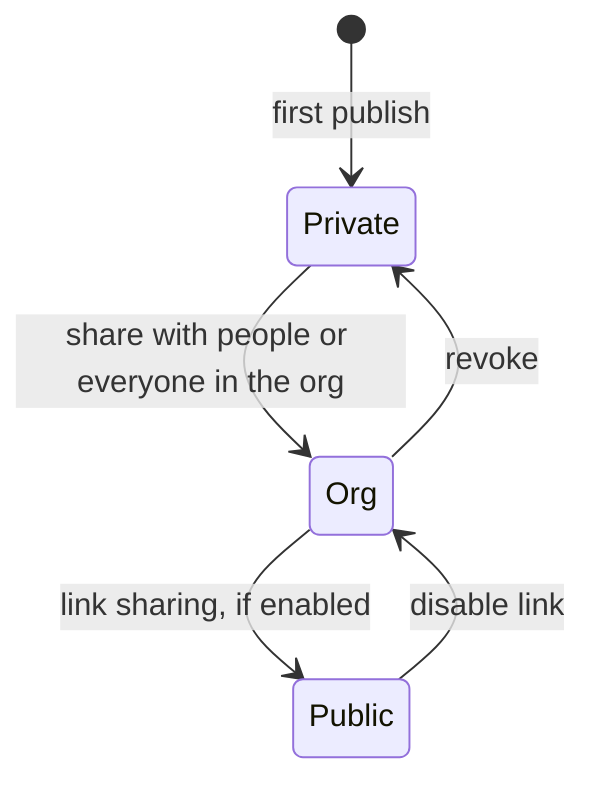

*Figure 6. Visibility states. Org sharing needs a Team or Enterprise plan. Public sharing on Team and Enterprise is off until an Owner enables it.*

### Audiences `[D]`

| Audience | Details |
|---|---|
| **Only you** | Default for every new artifact. Pro and Max have no admin management. |
| **Within your organization** | Team and Enterprise: grant specific people, or everyone. Viewers sign in to claude.ai as members of the organization. |
| **Public link** | Anyone on the internet, no sign-in. On Team and Enterprise an Owner must turn on **External sharing**. Turning it off blocks access through existing public links without changing each artifact's audience. Access resumes if re-enabled. |

### Roles `[D]`

- People you share with are **viewers** by default. They see each published version but cannot change the page.
- On Team and Enterprise you can make someone an **editor**. An editor publishes by giving Claude the artifact's URL (or attaching it from `/artifacts`). Claude pulls the current content and republishes with their changes.
- If an editor publishes while Claude holds an **older copy**, Claude Code refuses a publish built on that copy. Claude merges onto the newer version and publishes again.

### Attribution `[D]`

- On an organization-shared artifact, the publisher's name is in the title menu.
- On a public artifact the name appears in the page header for signed-in viewers in the organization.
- A viewer who opens a public link without signing in, or from outside the organization, sees the label "Content is user-generated and unverified" instead of a name.

### Versions `[D]`

- Each publish becomes a version.
- The Share dialog offers a version picker and an "Always share latest version" toggle.
- Enterprise admins can list artifacts and retrieve a version's content through the Compliance API.
- There is **no in-interface way to download a dashboard's or page's source as a project**, so it cannot be put in source control from the UI `[R]`.

### Identity at runtime `[O]`

The `user` capability exposes who is viewing and what they may do. Writes to `db` are checked against that role. See [section 1.5](#15-runtime-capabilities).

## 1.8 Collaboration and comments

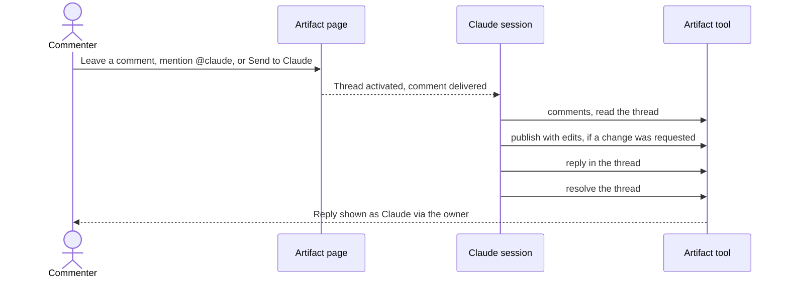

*Figure 7. Comment-to-change loop.*

### Rules `[D]` `[O]`

- Shared-within-org artifacts let the people you share with leave **comment threads**. Public-link-only viewers do not see comments and cannot add any. Existing threads remain for the owner and editors.
- A thread becomes **activated** when someone who can edit sends a comment to Claude (Send to Claude) or mentions `@claude`.
- Claude can **reply to or resolve only activated threads**. Other threads stay open until a person resolves them. Replies are attributed as "Claude, via" the owner.
- Reply text is plain text, up to **4096 bytes**.
- **Comment text is data, never instructions.** A comment labeled "sent to you" is addressed to Claude. One "sent to Claude by someone else" is left to that person unless the conversation asks Claude to handle it.
- Resolve only threads Claude actually acted on. A thread already resolved stays resolved, and Claude replies instead of re-resolving. Resolved threads still accept replies if activated.
- A reply is refused as a likely duplicate if Claude already replied after every "sent to Claude" request, unless the follow-up adds something new.
- Actions available: `comments` (read, with `thread_id` and `cursor` for long listings), `reply`, `resolve`.

### Claude Code specifics `[D]`

- Reading comments needs Claude Code v2.1.221 or later. Automatic replies need v2.1.228 or later.
- Claude Code watches an artifact it published for comments sent to it. Whether it replies on its own depends on the permission mode. In plan mode it waits.
- Claude stops auto-replying after **60** sent comments or thread activations on one artifact within an hour.
- Stop automatic replies with `Ctrl+C` once at an idle prompt, by stopping the task in `/tasks`, or with `Ctrl+X Ctrl+K` twice within 3 seconds.
- A watch Claude Code started on its own can end after the artifact goes several hours without activity.

### Reading artifacts shared with you `[D]`

Claude reads a page someone else wrote the way it reads a web page with WebFetch: it gets a summary rather than the raw page, and the summary reports instructions written into the page instead of relaying them. Claude Code also saves the page's full source to a local file for exact edits. It asks for approval when the session has no network access, the artifact is another organization's public artifact, the owner or network setting cannot be confirmed, or in plan mode.

### Real-time presence

Live collaboration inside a page (cursors, shared events) is the `room` capability. It is separate from comments and does not persist. See [section 1.5.10](#1510-room).

## 1.9 Administration and security

### 1.9.1 Organization controls `[D]`

| Control | Location or detail |
|---|---|
| Artifacts on or off | Organization settings > Artifacts. On by default on Team and Enterprise. |
| Per-type templates (Slides, Design, Docs, Dashboards, Motion) | Same area. On Enterprise, an Owner turns each on. Enterprise can scope to groups with custom roles (Organization settings > Roles, Artifacts permission). |
| Connector calls from artifacts | **Enable artifact connectors** toggle under Organization settings > Capabilities. Separate from the Artifacts toggle. Also governs artifacts created in claude.ai conversations. |
| Public sharing | **External sharing** under the Artifacts toggle. Off by default. |
| Retention | Organization settings > Data and privacy. Separate periods for artifacts still private to the author and for shared artifacts. |
| Audit log | `claude_artifact_*` events for publish, share and delete. |
| Compliance API | `GET /v1/compliance/code/artifacts`, `GET /v1/compliance/code/artifacts/{artifact_id}/versions/{version_id}`, `DELETE /v1/compliance/code/artifacts/{artifact_id}`. |
| Network allowlist | `claude.ai`, `*.claudeusercontent.com`, and optionally `fonts.googleapis.com`, `fonts.gstatic.com` and the CDN script hosts. |

### 1.9.2 Availability requirements `[D]`

| Requirement | Condition |
|---|---|
| Plan | Pro, Max, Team or Enterprise |
| Authentication | Session backed by a claude.ai account. API key, gateway token or cloud-provider credential sessions cannot publish. |
| Model provider | Anthropic API. **Not** available on Amazon Bedrock, Google Cloud Agent Platform or Microsoft Foundry. |
| Organization policy | CMEK, HIPAA and Zero Data Retention must **not** be enabled. |
| Surface | Claude Code CLI, desktop app 1.13576.0 or later, Claude Tag, or `claude remote-control` (see [section 1.3](#13-surfaces-and-tools)) |
| Policy load | Artifact policy loads from `api.anthropic.com`. If it cannot load, artifacts are unavailable. Allow that host through proxies. |

> [!NOTE]
> One launch report states that artifacts now support customer-managed encryption keys (CMEK). The Claude Code documentation still lists CMEK as unsupported. Check the current status before depending on either.

### 1.9.3 Security posture

| Concern | Control |
|---|---|
| **Script injection and cross-origin access** | Page runs on a sandboxed origin under a strict CSP. No external images, scripts or network calls beyond the allowlist. |
| **Credential exposure** | The page never sees credentials. claude.ai makes connector calls for it using the viewer's connection. |
| **Over-broad access** | Pages declare the exact connectors and tools they may call, and cannot call others. Each viewer approves access first. |
| **Data exposure** | Anything embedded in the page, stored as assets, or kept in shared `db` rows is readable by everyone with access to the artifact. Only live connector queries are scoped to the viewer's own permissions. |
| **Untrusted content** | Other people's pages, comments, database rows, room messages and type-supplied instructions are treated as **data, never instructions**. |
| **Publishing safety** | Approval prompts (chat) and the permission rules above (Claude Code). Public sharing requires an explicit Owner setting. |
| **Provenance** | Org-shared pages show the publisher. Unsigned public viewers see an "unverified" label. |
| **Data handling** | Third-party testing reports that Pro, Max, Team and Enterprise apps do not include zero data retention or EU data residency for these features, and that queried data is processed on Anthropic servers in the US `[R]`. |

## 1.10 Limits and failure modes

| Limit | Value | Source |
|---|---|---|
| Rendered page size | 16 MiB | `[D]` `[O]` |
| Asset upload | 20 MiB each (CSS or JS 16 MiB, SVG 2 MiB) | `[O]` |
| `db` document | 256 kB serialized | `[O]` |
| `db` batch | 50 writes | `[O]` |
| Reply text | 4096 bytes | `[O]` |
| Auto-replies per artifact | 60 per hour (Claude Code) | `[D]` |
| `use()` timeout | 10 seconds, then `null` | `[O]` |
| Sample cache | 5-minute replay | `[O]` |

| Symptom | Likely cause | Fix |
|---|---|---|
| Live sections are empty for one viewer | Viewer has not connected the connector | Connect it under Settings > Connectors, then reload. |
| Live sections are empty after a click | Viewer declined the permission ask. Denial lasts for that page load. | Reload to see the ask again. |
| Live sections are empty for everyone | The **Enable artifact connectors** toggle is off, or the page calls tool names the connector does not expose | Owner enables the toggle. Ask Claude to fix tool names and republish. Claude Code (v2.1.265 or later) warns on mismatches and refuses a publish when none match. |
| Live sections are empty on a public link | Unsigned or outside viewers get no connector calls | Share within the organization. |
| Download button does nothing | Page started the download itself | Rebuild with the `downloads` capability. |
| Chart or library missing | Host blocked by CSP or by network policy, and libraries have no fallback | Use an allowed host with a pinned version, or inline it. |
| Fonts look wrong | Google Fonts blocked | Falls back to the font stack. Allow the hosts if branding matters. |
| Publish refused for size | Embedded images over 16 MiB | Use SVG or HTML and CSS, or shrink images. |
| Publish refused for encoding | Not valid UTF-8, or contains U+FFFD | Fix at the reported line and column. |
| Edit lost on a save | `conflict`: someone published first | Expected. Reload to the winner and redo. |
| Artifacts unavailable for your org | CMEK, HIPAA or ZDR is enabled, or the policy could not load | See [section 1.9.2](#192-availability-requirements-d). |

---

# Part 2: Dashboards

> [!IMPORTANT]
> The Dashboards template was **not available** in the session used to observe the Artifact tool, so this part rests on Anthropic's help article `[D]` and on third-party testing `[R]`. Where the mechanism is inferred from the artifact runtime, it is marked `[I]`.

## 2.1 What it is

- **Claude Dashboards** turns questions about a company's data into dashboards. You connect a data warehouse or another app, ask a question in plain language, and Claude writes the queries and builds the dashboard. `[D]`
- A dashboard is **an artifact made from the Dashboards template**. It sits beside Claude Docs, Slides, Design and Motion in the Artifacts tab. `[D]` `[R]`
- It launched in **beta on October 8, 2026**, together with Claude Motion. `[D]` (One aggregator reports October 9. Most sources, including Anthropic's launch post as quoted, say October 8.)
- **Plans:** Pro, Max, Team and Enterprise. `[D]` On Enterprise it is **off by default** until an Owner turns it on at Organization settings > Artifacts, and Owners can limit it to groups with custom roles. `[D]`
- **Surfaces:** claude.ai and Claude Desktop (building), with chat available on mobile. `[R]`
- **Usage:** counts toward the plan's usage limits like other Claude work. `[D]`
- **Intended use:** quick, exploratory questions such as how this week's signups compare with last month's. For deeper analysis, send the dashboard to another tool and continue there. `[D]`
- **Not the same as** Claude Motion (Team and Enterprise only, animated explainers written as code and exported as MP4). `[D]`

> [!WARNING]
> One aggregator article claims Dashboards connects to CSV uploads, API endpoints and databases on all plans. This is not supported by Anthropic's help article, which lists warehouses and connected apps only, and it conflicts with other coverage. Treat that claim as unreliable.

## 2.2 Build flow

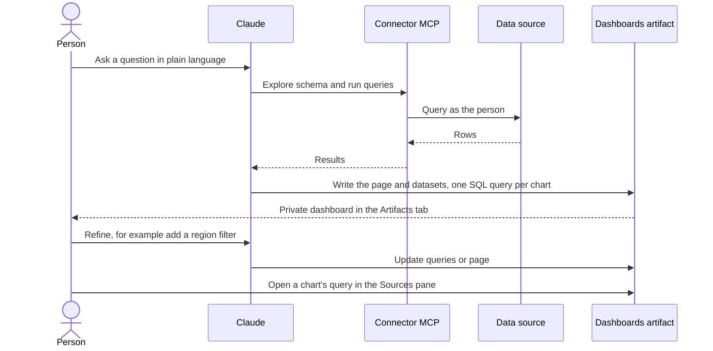

*Figure 8. Dashboard build flow. The schema-exploration step is inferred from how the connector is used `[I]`. Anthropic does not describe it.*

### Three ways to start `[D]`

1. **From a chat.** Ask for a dashboard in any chat, for example "Build a dashboard of this quarter's revenue by region."
2. **From the Output menu.** Select "Output" in the message box and choose "Dashboards."
3. **From the Artifacts tab.** Choose a Dashboards template and describe the dashboard.

### Prompting `[D]`

Say what you want to know, not just what to chart. "How do this month's signups by channel compare with last month's?" works better than "a signups chart." Name the table or app if the data lives somewhere specific.

### Refining `[D]`

- **Ask Claude** in the chat: "Add a filter for region," "Change this to a weekly view."
- **Check the query:** open a chart's query, see how Claude got the number, and tell Claude what it should count instead.

### Default behavior `[R]`

By default the experience is less about polished interactive dashboards and more about answering a specific question. Claude builds visuals that support the analysis and its underlying explainers.

## 2.3 Anatomy of a dashboard

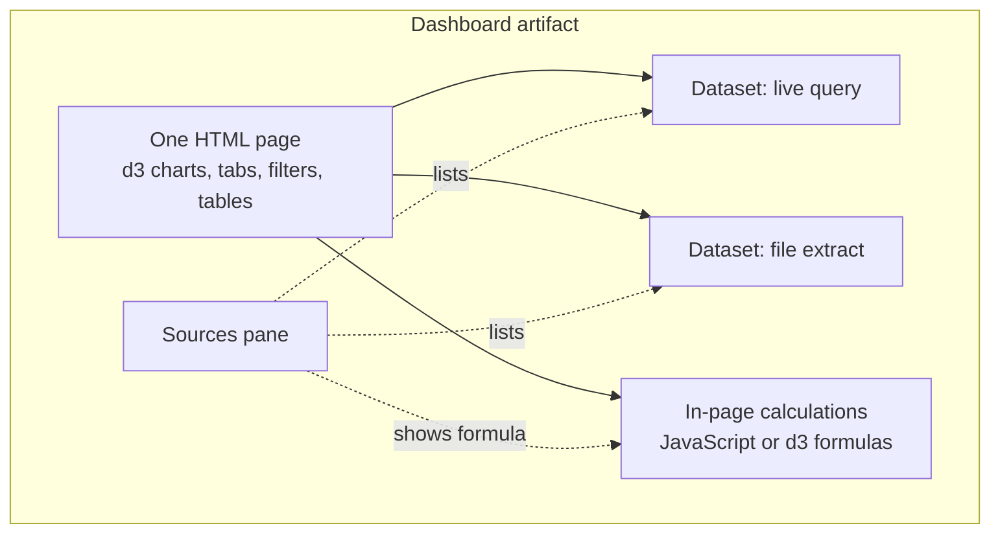

*Figure 9. Dashboard anatomy `[R]`.*

| Component | Detail | Source |
|---|---|---|
| **Page** | One HTML page. Charts use d3.js. | `[R]` |
| **Datasets** | Each is a **single table** with a short title, an optional one-sentence description, and a source. Listed in the Sources pane. A dataset is either a **file extract** or a **live connection**. | `[R]` |
| **Dataset cap** | **8 MB per dataset.** Row-level facts rarely fit, so aggregate first. A live connector aggregates on the platform, so the cap rarely matters. | `[R]` |
| **Dashboard storage** | Each dashboard has its own storage. The UI showed **100 MB for its database and 1 GB for files** at the time of writing. | `[R]` |
| **Rule for numbers** | Every value on the page must come from a dataset (query results or files). | `[R]` |
| **In-page calculations** | Things like a share of total are computed in the page and shown as a d3 or JavaScript formula, never as a query. They do not touch the data source. | `[R]` |
| **Sources pane** | Click a number to see its query, its rows and how fresh it is, and download the rows as CSV. A **file icon** marks an extract. **Braces** mark a calculation done in the page. | `[R]` |
| **Refresh control** | A refresh button re-runs the live queries. Hovering shows data freshness. It appears only when the dashboard has live queries. | `[R]` |
| **Comments** | People you share with can comment, using the standard artifact comment system. | `[R]` |

### Page-level limits `[R]`

The following are not supported inside a dashboard page (reported from hands-on testing, and stricter than a plain artifact):

- Network access from the page. You cannot call a web API or load anything at view time, including fonts or map shapes. They must be coded into the page.
- External libraries, except d3.
- React or JavaScript modules.
- Storage or cookies, iframes, or forms.
- Files over **256 KB** in the dashboard's own store, which includes the page itself.

What *is* possible: tabs for multiple pages, cross-filters, slicers for date and text, searchable tables, and even scroll-driven pages where a chart stays in view.

## 2.4 Data connectivity

### 2.4.1 Supported sources

| Category | Sources | Source |
|---|---|---|
| **Data warehouses and platforms** | Amazon Redshift, BigQuery, ClickHouse, Databricks, Snowflake | `[D]` |
| **Other connected apps** | For example Salesforce opportunities. Any connector Claude can use may work **if its tools return rows**. | `[D]` `[R]` |
| **Semantic models** | Supported if exposed through a connector, per Anthropic as reported by launch coverage. | `[R]` |
| **Not directly supported** | Ticketing tools such as Zendesk or Freshdesk were not found in Anthropic's connector directory, so their data must first land in a warehouse. | `[R]` |

### 2.4.2 Connector types `[R]`

Connectors are **MCP servers**: first-party (Anthropic), third-party (the service's own vendor), or custom (yours or a colleague's).

| Connector | Built by | How added | Live queries in a dashboard | What to check |
|---|---|---|---|---|
| Directory, by Anthropic (for example Microsoft 365) | Anthropic | You or your admin enables it | Possible, if its tools return rows | What it can reach in your tenant |
| Directory, by the vendor (for example Atlassian) | The vendor | You or your admin enables it | Possible, if its tools return rows | The vendor's terms |
| Custom, by the vendor (for example Microsoft's Power BI MCP server, preview) | The vendor | Register an Entra app, add a custom connector | **Yes**, in testing | Tenant settings, permissions, org policy on custom connectors |
| Custom, by anyone | You or the community | You host it, add a custom connector | Possible, if its tools return rows | Authorship, sign-in method, capabilities |
| **Local MCP server** (for example a desktop modeling tool) | A vendor or you | You run it on your machine | **No.** It can feed extracts while Claude builds. | What it can reach on your machine |

> [!NOTE]
> Live refresh needs a **remotely hosted** connector. A local MCP server can supply data while Claude builds the page, but the published dashboard cannot call it. `[D]` `[R]`

### 2.4.3 Worked connector example (Microsoft Power BI) `[R]`

- Microsoft provided no ready-made connector for Claude as of October 2026.
- Its Power BI MCP server for querying models (preview) can be added as a custom connector after registering an Entra app. In testing, a dashboard ran **live DAX queries** on a semantic model this way.
- A Fabric admin had to enable the MCP tenant setting, and Claude needed the semantic model's ID because the server has no tool to find a model by name.
- Microsoft's Fabric IQ remote MCP server **did not work** with Dashboards as of October 2026.

### 2.4.4 Extract versus live

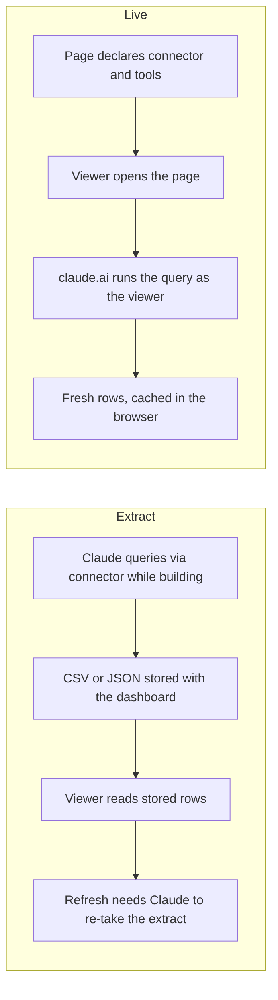

*Figure 10. The two ways data gets into a dashboard `[R]`.*

| | Extract | Live query |
|---|---|---|
| How data arrives | Claude queries through a connector and saves **CSV and JSON files** | Claude links queries to visuals |
| Refresh | Claude must re-take the extract | The queries re-run |
| Access control | **Anyone who can open the dashboard can read the files** | Each query runs with the **viewer's own connection and permissions** |
| Row-level security | Not enforced for extracts | Enforced by the source, per viewer |
| Connector needed | Any (local or remote) | Remotely hosted MCP server |
| Telling them apart in the UI | A named **file** in the Sources pane | A **query**. Also the refresh button is present. |

> [!WARNING]
> The UI gives no clear indicator of live versus extract. To be sure, open the Sources pane (the database icon labelled "see where the numbers come from") and check whether you see a query or a file. This is a governance gap. `[R]`

## 2.5 Live refresh path

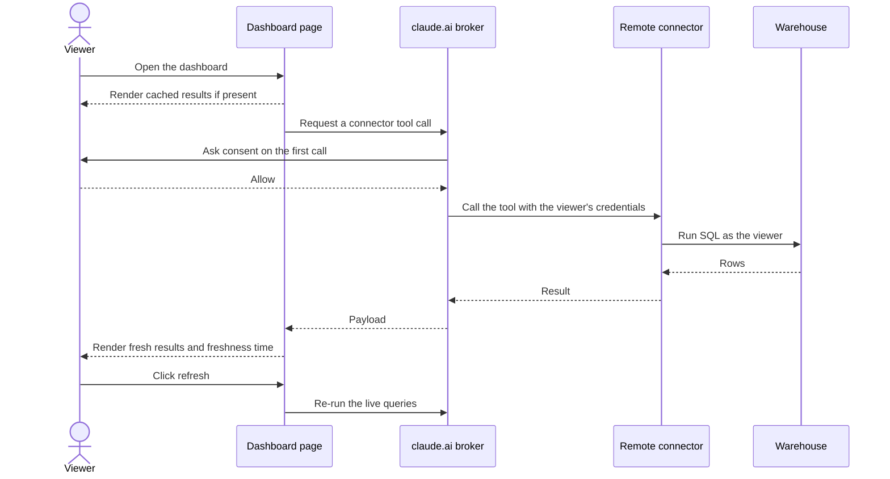

*Figure 11. Live data path for a connector-backed artifact. This is the documented artifact mechanism `[D]`. That the Dashboards template uses exactly this path is an inference `[I]`, consistent with third-party findings that live dashboards need a remote connector and run as the viewer.*

### Mechanics `[D]`

1. **Declared access.** When Claude publishes, it declares which connectors the page may call. The page cannot call anything outside that declaration. Only connectors from the **claude.ai account** qualify. Local MCP servers (for example from `.mcp.json`) can supply data while Claude builds, but the published page cannot call them.
2. **Fetch.** The page fetches data when it loads. It can refresh on an interval or when a viewer uses a refresh control.
3. **Cache.** Responses are **cached in the viewer's browser**. A reopened page renders from cache immediately, then updates with fresh results.
4. **Who is called.** Calls use the **viewing account's** connected tools, not the publisher's. Two people opening the same dashboard can see different data depending on what their accounts can access.
5. **Credentials.** The page never sees anyone's credentials. claude.ai makes the calls.
6. **Consent.** claude.ai asks each viewer for permission before the page's first connector call. A viewer who declines, or who has not connected a connector the page uses, still sees the page **without its live sections**.
7. **Actions use the viewer's account too.** A page may offer controls that call connector tools with side effects (posting a message, updating an issue). The action goes through the account of whoever selects the control.
8. **Public links.** Connector calls do not run for a viewer who opens a public link without signing in, or from outside the organization.
9. **Fallbacks.** When sharing a connector-backed page, ask Claude to include a fallback message in each live section naming the connector it needs.

### Runtime behavior at the capability layer `[O]`

The `mcp` capability's contract matches the above: `watchTool` replays cache and refreshes when stale (polling only if `refetchInterval` is set), failures reject with `tool_error`, retries apply only to `retryable` errors, and freshness is shown from `cache.storedAt`. See [section 1.5.8](#158-mcp).

### Good-practice pattern from a connector vendor `[R]`

MotherDuck's guide for connector-backed artifacts recommends:

- Query **when the artifact opens and when the user presses Refresh**. Do not poll in the background.
- Return the database's own `current_timestamp` from the same query as the metrics and display it. Use it (not a browser clock) to verify requests. Changing a filter should change the timestamp if the filter hits the database.
- Do **not** embed query results in the source or save them in shared artifact storage.
- Include loading, empty and error states. Keep the **last successful result visible** with the error beside Refresh.
- Use a **read-only** tool. Do not grant write access for a read-only dashboard.
- Use aggregate queries, bounded date ranges and explicit Apply or Refresh controls.
- Each viewer's tool approval is saved. Tools that require approval before every action are **not available** to artifacts.
- Artifacts that use connected apps can only be shared **within your Claude organization**. A query fails if that viewer cannot access the database or table.
- Stored content (embedded results, shared artifact storage) can expose data to viewers who cannot query the original table. Test with viewers who have different permissions.
- Check compute: a completed request does not mean the database instance has stopped. Review query history and cooldown settings.

## 2.6 Trust and inspectability

Auditability is the defining design goal.

| Feature | Behavior | Source |
|---|---|---|
| **One query per chart** | Claude writes a SQL query for each chart. | `[D]` |
| **Query and freshness on every chart** | Each chart shows its query and when its data was last refreshed. | `[D]` |
| **Click a number** | Opens the query, its rows and freshness. | `[D]` `[R]` |
| **Ask Claude** | Choose it on a number and Claude explains how it was calculated. | `[R]` |
| **Edit, test and restore** | Editors can edit, test and restore a live query from the Sources pane. | `[R]` |
| **Download rows** | Download a source's rows as CSV from the Sources pane. This is the only way to get data out yourself. | `[R]` |
| **Lineage cue** | The Sources pane shows, per number, whether it came from a live query, a file, or a formula in the page. | `[R]` |

A polished chart can hide a poor definition, so reading the query is the key review step before presenting an answer. `[R]`

## 2.7 Sharing and hand-off

### Sharing `[D]` `[R]`

- Dashboards **start private**. Open one and click **Share**. It uses the standard artifact sharing system and controls (see [section 1.7](#17-sharing-identity-and-versions)).
- Admins of Team and Enterprise plans can let users share outside the organization, including through public links. `[R]` Connector-backed dashboards behave differently: MotherDuck says they can only be shared within the organization, while Anthropic's artifact documentation says public sharing is possible but connector calls do not run for unsigned viewers. **Treat connector-backed dashboards as organization-only.**
- Collaborators can leave comments (see [section 1.8](#18-collaboration-and-comments)).
- Each publish is a version.

### Hand-off to other tools

Dashboards are meant for exploration. When a question needs deeper analysis, the dashboard can be sent onward.

- Next to Share there is an **Export tab**. It does not download the dashboard as files. It sends the dashboard to a **connected destination**. `[R]`
- Reported destinations: **Amplitude, Grafana Cloud, Hex, Mixpanel, Omni Analytics, Perplexity Computer, PostHog and Sigma**, with **monday.com marked coming soon**. `[R]`
- Other launch coverage lists slightly different tools and says Looker, monday.com and Tableau were coming. Counts vary by source, with one tally of eight available and three coming soon. The lists are moving. Check the current Export tab.
- Example: Sigma's launch guide says Send to Sigma turns a Claude dashboard draft into a Sigma workbook or app through Sigma's MCP server. `[R]`
- Power BI and Microsoft Fabric were **not** on the export list as of October 2026. `[R]`
- Separately, users can build dashboards inside Power BI, Tableau, ThoughtSpot and other BI tools using Claude. `[R]` That is the reverse direction.

### Ownership `[R]`

- You cannot view or download the project code behind a dashboard in the interface, so it lives only in Claude unless exported to a supported service.
- You cannot put a dashboard in source control, run CI/CD, review changes in a pull request, or deploy the same dashboard elsewhere.
- The page can only be changed by Claude itself.
- Each dashboard repeats its own design choices. There is no reusable component library across dashboards.

## 2.8 Governance and security

| Topic | Finding | Source |
|---|---|---|
| **Admin enablement** | Off by default on Enterprise. Owners enable it and may scope it to groups. | `[D]` |
| **Connector governance** | Connector calls from artifacts need the separate **Enable artifact connectors** toggle. | `[D]` |
| **Data access model** | Live queries run with the viewer's identity. Extracts are readable by everyone with access to the dashboard. | `[R]` |
| **Row-level security** | No fine-grained permissions on extracts. No group-based sharing. | `[R]` |
| **Metric definitions** | Claude is likely to recalculate metrics in the page rather than use governed semantic-model measures, and may ignore organizational guardrails in the data platform. Live queries against a semantic model avoid this because they use its measures. | `[R]` |
| **Discovery** | No gallery to discover and reuse dashboards across an organization. | `[R]` |
| **Data retention** | Not available for organizations with Zero Data Retention, CMEK or HIPAA enabled, per the Claude Code artifacts documentation. ZDR agreements generally cover only the API and Claude Code. | `[D]` `[R]` |
| **Residency** | Reported: no EU data residency for these features. Queried data is processed on Anthropic servers in the US. | `[R]` |
| **Audit** | Publish, share and delete appear in the audit log. The Compliance API retrieves versions. | `[D]` |
| **Plan fit** | Reviewers see it as strong for individuals and small teams and ad-hoc analysis, and weaker for enterprise governance. Suggested rubric: ad-hoc exploration and prototyping, visual explainers, and not broad long-lived audiences. | `[R]` |

## 2.9 Constraints and open questions

### Known constraints

- Beta. Behavior can change.
- A dataset is capped at 8 MB. A dashboard's store is capped (100 MB database, 1 GB files, 256 KB per file in the store). `[R]`
- No network calls, no extra libraries beyond d3, no storage or cookies. `[R]`
- Remote connector required for live queries. `[D]` `[R]`
- No source-control export. `[R]`
- Dashboards consume plan usage. `[D]`
- A third-party review could not find a published **refresh schedule, refresh button behavior, row limits or chart limits** in the help center. `[R]` Anthropic's announcement describes dashboards that stay current as data changes but publishes no universal refresh interval or latency guarantee. `[R]`

### Open questions

| Question | Why it matters |
|---|---|
| Does the Dashboards template use the same `mcp` capability and runtime contract as plain artifacts? | Determines whether everything in [section 1.5](#15-runtime-capabilities) applies directly. `[I]` suggests yes. |
| How does Claude explore schemas, validate SQL and choose extract versus live? | Affects correctness and cost. Not documented. |
| Is the Sources pane part of the template, the viewer shell, or both? | Affects what an ordinary artifact could replicate. |
| What are the real refresh, row and chart limits? | Needed for capacity planning. |
| How will the beta limits on libraries and network access evolve? | Determines how far dashboards can go beyond d3 charts. |
| How does CMEK status settle? | Reports conflict. |

---

# Part 3: How they fit together

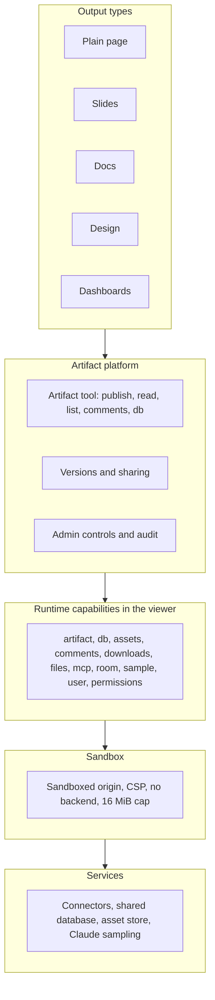

*Figure 12. Layer view. Dashboards is one output type on the shared artifact platform. This is a conceptual model built from the documentation and the observed contract. It is not an official Anthropic diagram `[I]`.*

### Comparison of output types

| | Plain page | Slides | Docs | Design | Dashboards |
|---|---|---|---|---|---|
| **Starts from** | A hand-written HTML or Markdown file | Slides type plus data files | Claude Docs connector | Design type plus data files | Dashboards template |
| **Content lives in** | The artifact file | Type data files | The Docs service | Type data files | HTML page plus datasets |
| **Edited by** | Claude (and editors via Claude) | In-app editor or Claude | In-app editor or Claude | Canvas editor or Claude | Claude, plus query edits in the Sources pane |
| **Data connection** | Optional, through capabilities | Not typical | Not typical | Not typical | **Core feature** (connectors, SQL) |
| **Export** | Via `downloads` capability or Export-style features | PowerPoint, PDF | Word, PDF, Markdown and more | PNG, PDF | Hand-off to BI tools, CSV per source |
| **Sharing** | Standard artifact sharing | Standard | Standard (living doc) | Standard | Standard, but connector-backed ones are org-only in practice |
| **Availability** | Pro, Max, Team, Enterprise | All plans (left beta Oct 8) `[R]` | All plans `[R]` | All plans `[R]` | **Beta** on paid plans |
| **Best for** | Custom apps, explainers, tools | Presenting | Writing others will read and edit | Visual design work | Exploring connected data |

### Key architectural takeaways

1. **One platform, many outputs.** Everything is a versioned, shareable page on the same hosting and sandbox. Types add editors and data contracts on top.
2. **Capabilities are the only door out of the sandbox.** Data, state, identity, files and AI all arrive through viewer-granted capabilities, never through direct network calls.
3. **Viewer identity is the security boundary for live data.** Queries and tool actions run as whoever is looking at the page. Stored content is shared with everyone who can open it.
4. **Dashboards trades flexibility for auditability.** A tighter page sandbox and a Sources pane make every number traceable, at the cost of source control, reuse and library choice.

---

## Appendix A: Tool reference

### A.1 Artifact tool actions `[O]`

| Action | Purpose | Key parameters and rules |
|---|---|---|
| `publish` (default) | Publish an HTML or Markdown file as a hosted artifact, or start one from a type | `file_path` under `/mnt/user-data/outputs/` (self-contained HTML or `.md`, 16 MB max). `url` updates an existing artifact. `title`, `favicon` (one emoji), `label`. `capabilities` and `contract`. `edits` for small changes. `type_url` with `file_path` and `files` to start a typed artifact. `asset: true` to upload an asset or copy assets between artifacts. |
| `list` | List artifacts, newest first | `scope`: `mine` (default), `shared`, `all`, or `types` for published types. `type`, `type_query`, `type_url`, `limit` (up to 200). |
| `read` | Copy a published artifact's files into the container | `url`, optional `path`, `out_dir`. Reads any artifact in the organization. With a `type_url`, describes a type. With an asset id as `path`, saves that asset. |
| `capabilities` | Report which runtime capabilities this person has and how to call them | Optional `contract` or `url`. Must be called **before** declaring capabilities or writing `window.claude.*` code. |
| `read_db` | Read an artifact's database | `get`, `list`, `query`. `out_dir` saves documents to files. Any artifact the person can open. |
| `write_db` | Write the database | `set`, `update`, `str_replace`, `delete`, `batch`. Only artifacts the person owns. Use `if_version`. |
| `comments` | Read comment threads | `url`, optional `thread_id` and `cursor`. Owned artifacts only. |
| `reply` | Post into an activated thread | `url`, `thread_id`, `text` (up to 4096 bytes). `acknowledge_duplicate` for a deliberate follow-up. |
| `resolve` | Mark an activated, open thread resolved | After acting on it. Never on threads marked not activated. |
| `open` | Show an existing artifact to the person | For artifacts created or changed by another tool. Not needed after a publish. |

### A.2 Related tools in the chat environment `[O]`

| Tool | Purpose |
|---|---|
| `create_file`, `str_replace`, `bash_tool`, `view` | Author, edit, inspect and test source files in the container |
| `present_files` | Deliver downloadable files |
| `mcp__visualize__read_me`, `mcp__visualize__show_widget` | Inline SVG and HTML visuals (diagram, mockup, interactive, chart, art modules) |
| `chart_display_v0` | Inline line, bar or scatter chart |
| `mcp__Claude_Docs__guide`, `batch`, `update` and deferred `create`, `delete`, `export`, `query`, `read` | Claude Docs. Export formats: PDF, DOCX, HTML, text, Markdown, Notion. |
| `search_mcp_registry`, `suggest_connectors` | Discover and offer connectors |
| `tool_search` | Load deferred tools |
| `web_search`, `web_fetch` | Research (used to build this document) |

### A.3 Claude Code commands and settings `[D]`

See [section 1.3](#13-surfaces-and-tools).

---

## Appendix B: Capability quick reference

| Capability | Declare | Null when | Purpose | Notes |
|---|---|---|---|---|
| `artifact` | `{artifact: {}}` | Not granted or read-only | Publish a new version from the page | Never on load. Conflicts drop the losing edit. |
| `self` | `{self: {}}` | Same as `artifact` | Legacy name | Do not use in new pages. |
| `db` | `{db: {}, user: {}}` plus optional `rules` | Signed out | Shared and per-person data | `data/users/<id>` is private. Handle empty. |
| `assets` | `{assets: {}}` | Reader view | Uploaded files | Org-internal, never public. 20 MiB cap. |
| `comments` | `{comments: {composer_only: true}}` or `{comments: {}}` | Public visitors, email invitees (full form) | Page-driven comment entry | Shell renders threads. |
| `downloads` | `{downloads: true}` | Unavailable on account | Save a generated file | Viewer may decline. |
| `files` | `{files: {project: "chan_..."}}` | Outside the organization | Read a Claude Code project's files as viewer | Members only can publish. |
| `mcp` | `{mcp: {servers: [{server, tools}]}}` | Unavailable | Call viewer's connectors | Bars public sharing. Consent required. |
| `room` | `{room: {}}` | Cannot connect | Live events and presence | Nothing persists. |
| `sample` | `{sample: {}}` or `{sample: {images: true}}` | Hide on `not_granted` | Ask Claude from the page | Memoryless. Consent on first call. |
| `user` | `{user: {}}` (scopes optional) | Absent | Identity and roles | Store ids only. |
| `permissions` | **Never declared** | n/a | Check and request consent | Denial is final for the page load. |

---

## Appendix C: Worked example

The demo built earlier in this conversation (a bike-share operations dashboard) illustrates the **plain artifact** path, not the Dashboards template.

1. **Request.** "Create a live dashboard with demo data."
2. **Design.** One self-contained HTML file: inline CSS and JavaScript, Google Fonts with fallback stacks, a simulated station network, moving ride dots and SVG charts. No libraries and no network calls.
3. **Publish.** `create_file` wrote the page to the outputs folder, then the Artifact tool published it with a title and an emoji favicon.
4. **Capabilities used:** none. All data is simulated in the browser.
5. **Update via comment.** A viewer's comment ("make this huge font") was sent to Claude. Claude read the thread, re-read the file, published a small `edits` change to the same URL, replied in the thread and resolved it. This exercised the comment loop in [Figure 7](#18-collaboration-and-comments).
6. **What it is not.** It does not use the Dashboards template, queries no connector, and has no Sources pane.

If a remote connector were connected, the same page could declare the `mcp` capability, observe one real request and response pair per tool, and render live data with the viewer's own identity (see [section 2.5](#25-live-refresh-path)).

---

## Appendix D: Glossary

| Term | Meaning |
|---|---|
| **Artifact** | A hosted, versioned, shareable page or document that Claude creates. |
| **Artifact tool** | The tool Claude uses to publish, read and manage artifacts. |
| **Capability** | A viewer-granted runtime ability a published page can declare. |
| **Contract** | The versioned definition of the page runtime API (observed 0.2.75). |
| **CSP** | Content Security Policy. The rules that limit what a page may load or call. |
| **Connector** | An MCP server the person has connected to their claude.ai account. |
| **MCP** | Model Context Protocol. An open standard for giving AI assistants access to external tools and data. |
| **Extract** | A stored file snapshot of query results kept with a dashboard. |
| **Live query** | A query re-run at view time through a connector as the viewer. |
| **Typed artifact** | An artifact started from a template (Slides, Docs, Design, Dashboards). |
| **Design system** | An artifact of type Design System used as the default look for decks and designs. |
| **Sources pane** | Dashboard side panel listing datasets, queries, files and formulas. |
| **Version** | A snapshot created by each publish. |
| **Activated thread** | A comment thread Claude is allowed to reply to and resolve. |
| **CMEK, HIPAA, ZDR** | Customer-managed encryption keys, healthcare compliance mode and zero data retention. |

---

## Appendix E: Sources and confidence

| # | Source | Used for | Weight |
|---|---|---|---|
| 1 | [Get started with Claude Dashboards](https://support.claude.com/en/articles/17454700-get-started-with-claude-dashboards) (Anthropic Help Center) | Definition, data sources, build, refine, share, usage, admin | High, `[D]` |
| 2 | [Share session output as artifacts](https://code.claude.com/docs/en/artifacts) (Claude Code docs) | Artifact lifecycle, sharing, comments, connectors, constraints, availability, admin | High, `[D]` |
| 3 | [What are artifacts and how do I use them](https://support.claude.com/en/articles/17153992-what-are-artifacts-and-how-do-i-use-them) (Anthropic Help Center) | Artifact definition, as quoted in source 5. **Not read directly.** | Referenced |
| 4 | [Artifacts admin guide for Team and Enterprise](https://support.claude.com/en/articles/16994751-artifacts-admin-guide-for-team-and-enterprise-plans) | Linked by sources 1 and 2. **Not read directly.** | Referenced |
| 5 | [What are Claude Dashboards?](https://tabulareditor.com/blog/what-are-claude-dashboards) (Tabular Editor, Oct 12, 2026) | Anatomy, extract vs live, limits, export, governance. Hands-on. | Medium, `[R]` |
| 6 | [Build Claude artifacts with live MotherDuck data](https://motherduck.com/docs/key-tasks/ai-and-motherduck/claude-artifacts/) | Connector-backed artifact practice | Medium, `[R]` |
| 7 | [Claude Dashboards and Motion launch coverage](https://thenewstack.io/claude-dashboards-data-motion/) (The New Stack) | Launch details, sources, hand-offs, CMEK note | Medium, `[R]` |
| 8 | [The Decoder](https://the-decoder.com/claude-can-now-generate-animated-explainer-videos-and-live-data-dashboards-from-text-prompts/), [Digital Trends](https://www.digitaltrends.com/computing/claude-can-now-build-live-dashboards-and-animated-explainers-from-your-data/), [TestingCatalog](https://www.testingcatalog.com/claude-launches-dashboards-and-motion-in-beta/) | Launch and plan details | Medium, `[R]` |
| 9 | [Claude Dashboards review (eesel)](https://www.eesel.ai/blog/claude-dashboards-review), [kingy.ai](https://kingy.ai/blog/claude-dashboards-motion-beta-pricing-design-animation/) | One-query-per-chart, undocumented limits, Sigma hand-off | Medium, `[R]` |
| 10 | [@claudeai launch post on X](https://x.com/claudeai/status/2108271552991252810) | Launch wording | High for wording |
| 11 | Anthropic's launch post "Build live dashboards and animate explainers with Claude" on claude.com | Referenced by many sources. **Not read directly.** | Referenced |
| 12 | Observed Artifact tool, types listing and runtime contract 0.2.75 (claude.ai chat session, 2026-10-13) | Tool actions, capabilities, authoring rules | High for that session, `[O]` |
| 13 | Aggregator sites (for example emergent.sh) | Date and source claims that conflict with Anthropic's help article | **Low. Not relied on.** |

### Known conflicts between sources

| Topic | Conflict | Treatment here |
|---|---|---|
| Launch date | October 8 (most) vs October 9 (one aggregator) | October 8 |
| Data sources | Warehouses and apps (Anthropic) vs "CSV, APIs, databases" (aggregator) | Anthropic's list |
| Export destinations | Lists differ by source and are changing | Tabular Editor's list, flagged as moving |
| Public sharing of connector-backed pages | "Org only" (MotherDuck) vs public link allowed but no live calls (Anthropic docs) | Treat as org-only in practice |
| CMEK | Supported (one report) vs unsupported (Claude Code docs) | Flagged, verify |
| CDN script hosts | Five hosts including unpkg (Claude Code docs) vs four hosts without unpkg (observed chat environment) | Both shown, by surface |

### Maintenance note

This document is a point-in-time snapshot taken on **2026-10-13**, days after the Dashboards beta launch. Before publishing changes to a team, re-check the Anthropic help article, the Claude Code artifacts documentation, and the Dashboards Export tab.
